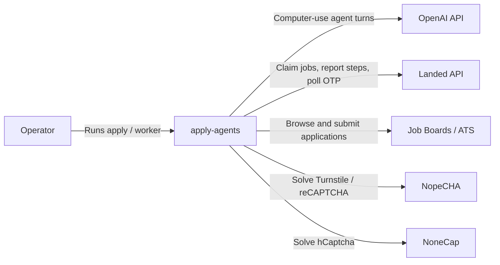
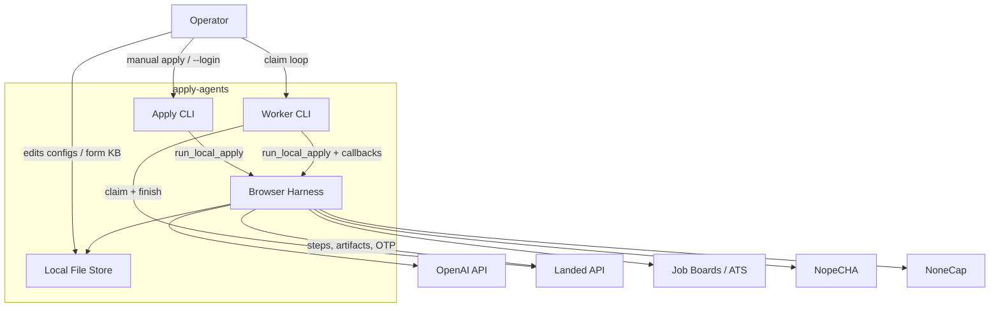
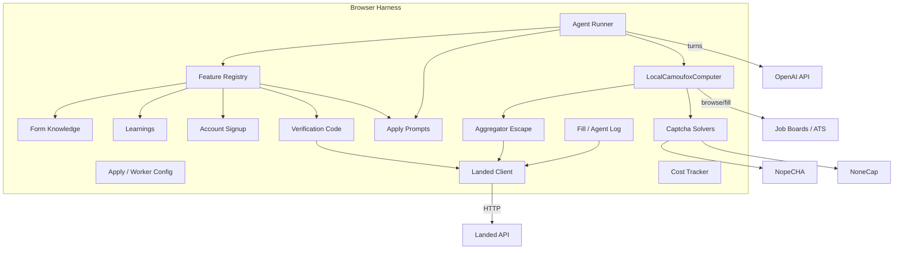

# Architecture (C4)

Structurizr DSL source: [`workspace.dsl`](workspace.dsl).

Validated and exported via Structurizr (`SystemContext`, `Containers`, `Components`).

## Level 1 — System Context

**apply-agents** is a local Camoufox + OpenAI computer-use applier. It either applies to one URL from config or claims jobs from Landed’s worker API. There is no in-repo HTTP server or DB — persistence is local JSON + browser profile.

## Level 2 — Containers

| Container | Role | Entry |
|---|---|---|
| Apply CLI | Single-job apply, login, NopeCHA cache | `job-apply` / `python -m computer_use.apply` |
| Worker CLI | Poll Landed, claim, apply, finish | `job-worker` / `python -m computer_use.worker` |
| Browser Harness | Camoufox + agent loop + features + captcha | `browser/local.py` |
| Local File Store | Configs, KB, learnings, costs, profile, resumes | repo root / `.cache` / `.camoufox-profile` |

## Level 3 — Components (Browser Harness)

## Files

| File | Description |
|---|---|
| [`workspace.dsl`](workspace.dsl) | Structurizr workspace (source of truth) |
| [`SystemContext.mmd`](SystemContext.mmd) | Exported Mermaid (styled) |
| [`Containers.mmd`](Containers.mmd) | Exported Mermaid (styled) |
| [`Components.mmd`](Components.mmd) | Exported Mermaid (styled) |

To re-export from Structurizr Lite / CLI, open `workspace.dsl` and export views `SystemContext`, `Containers`, and `Components`.
